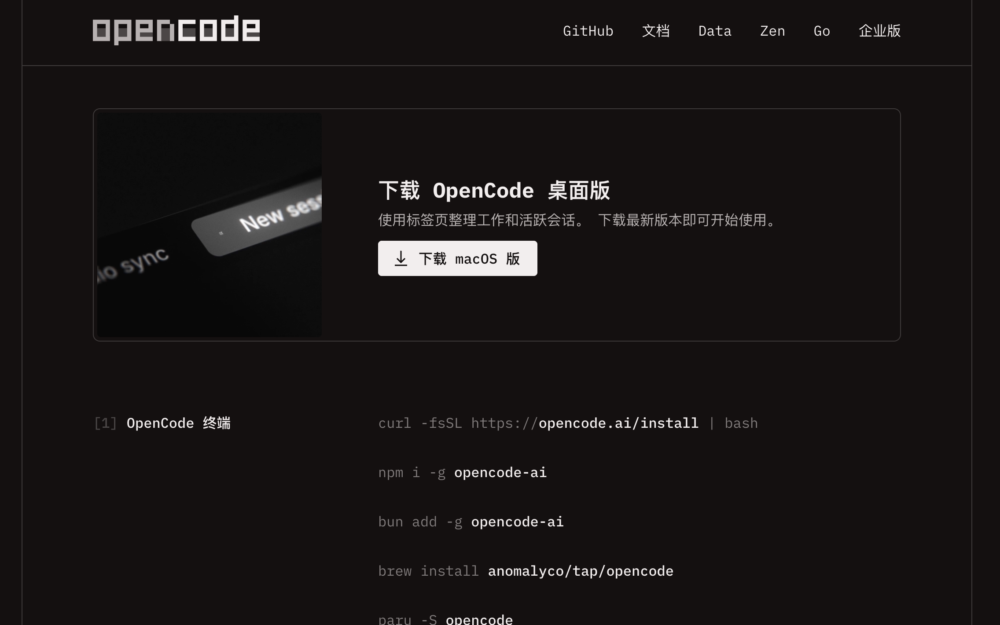
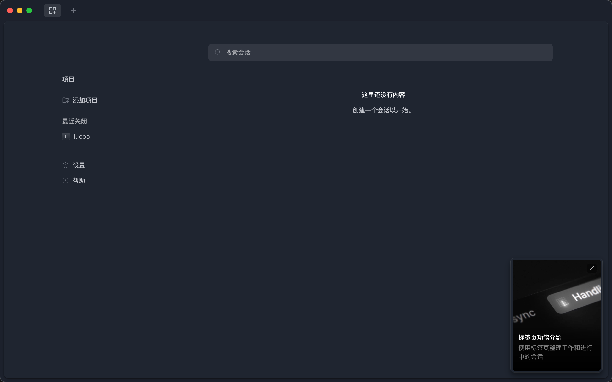
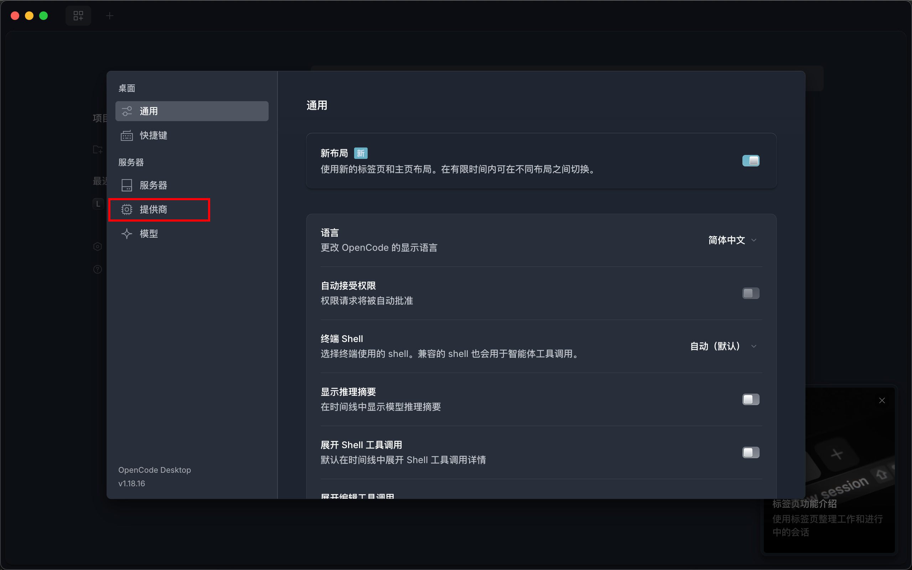
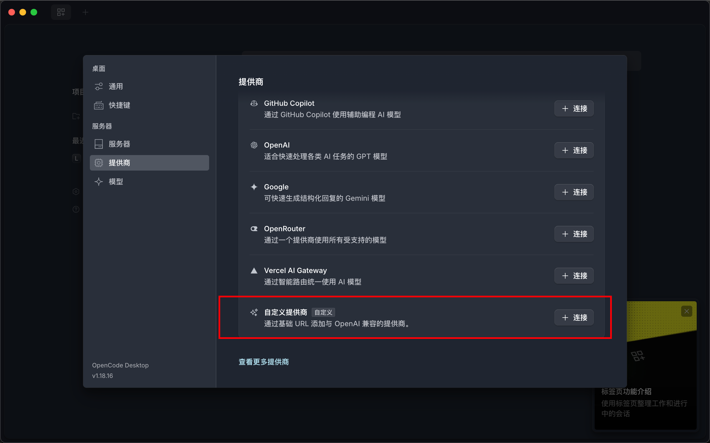
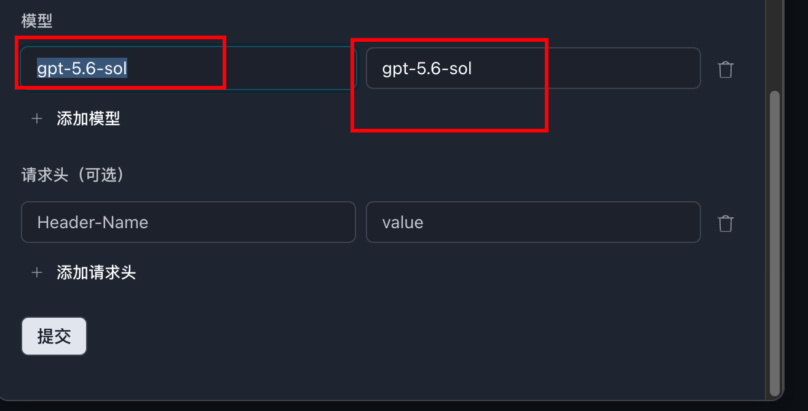
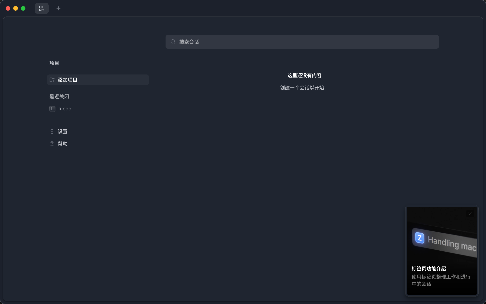
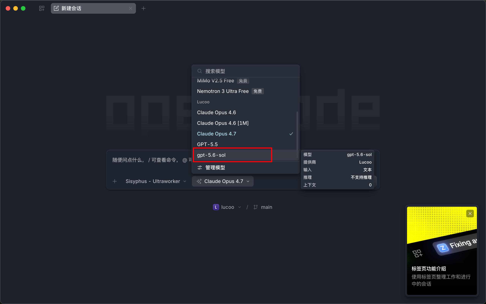
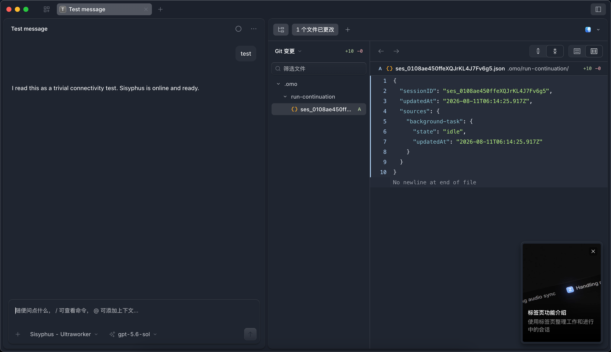

OpenCode 桌面版支持添加自定义模型提供商。通过 OpenAI 兼容接口接入 Lucoo 后，不需要手动维护复杂的启动参数，就能在图形界面中选择模型、添加项目并新建会话。

<div style="border:2px solid #ef4444;background:#fff1f2;color:#991b1b;padding:14px 16px;border-radius:12px;font-size:18px;font-weight:700;line-height:1.7;margin:18px 0;">
重点：Base URL 填 <code>https://cc.lucoo.net/v1</code>；凭证必须使用 Lucoo 后台创建的 <code>sk-</code> 开头 API Key，不能填写兑换码。</div>

## 一、开始前准备

### 常用地址

| 用途 | 地址 |
| --- | --- |
| Lucoo 中转站 | [https://cc.lucoo.net](https://cc.lucoo.net) |
| 海外代理入口 | [https://apicc.lucoo.net](https://apicc.lucoo.net) |
| 额度购买 | [https://pay.ldxp.cn/shop/Lucoo](https://pay.ldxp.cn/shop/Lucoo) |
| OpenCode 桌面版下载 | [https://opencode.ai/zh/download](https://opencode.ai/zh/download) |
| OpenCode 提供商文档 | [https://opencode.ai/docs/zh-cn/providers/](https://opencode.ai/docs/zh-cn/providers/) |

### 配置速查

| 配置项 | 推荐填写 |
| --- | --- |
| 提供商名称 | `Lucoo` |
| Provider ID | `lucoo` |
| Base URL | `https://cc.lucoo.net/v1` |
| API Key | Lucoo 后台创建的 `sk-...` 密钥 |
| 令牌分组 | OpenAI 兼容分组，例如 `pro` 或 `plus` |
| 模型 ID | 以 Lucoo 后台当前显示的可用模型为准 |

<p class="lucoo-token-warning-block">OpenCode 这里走的是 OpenAI 兼容接口，不要选择 Claude 专用分组。模型名称也不要照搬本文截图，后台显示什么模型 ID，就填写什么模型 ID。</p>

## 二、创建 Lucoo API Key

已经有可用 `sk-` 密钥的用户，可以跳到下一节；没有 Key 的用户按下面步骤创建。

### 1. 注册并登录 Lucoo

打开 [https://cc.lucoo.net](https://cc.lucoo.net)，按页面提示注册并登录。如果已经购买兑换码，先进入钱包或兑换页面完成余额兑换。

### 2. 进入令牌管理

登录控制台后，打开「令牌管理」或「API 密钥」页面，然后点击「添加令牌」。不同版本的后台文字可能略有区别，但入口都在个人控制台中。

### 3. 创建 OpenAI 兼容令牌

建议按下面方式填写：

| 配置项 | 建议 |
| --- | --- |
| 名称 | 方便自己识别，例如 `OpenCode Desktop` |
| 分组 | 优先选择 `pro`；轻量使用可选择 `plus` |
| 过期时间 | 按自己的安全要求设置，也可以暂时不过期 |
| 额度 | 保持默认，或为单个客户端设置独立限额 |
| 模型限制 | 新手先不限制，确认连通后再按需收窄 |

创建完成后，复制完整的 `sk-` 开头 API Key。这个密钥只会用于后面的 OpenCode 配置，不要把它发到群聊、截图或代码仓库中。

## 三、下载并打开 OpenCode 桌面版

打开 [OpenCode 下载页面](https://opencode.ai/zh/download)，根据自己的系统下载 macOS、Windows 或 Linux 版本。



安装完成后启动 OpenCode。首次进入时可以暂时不添加项目，先完成模型提供商配置。



## 四、添加 Lucoo 自定义提供商

### 1. 进入模型提供商设置

点击 OpenCode 的设置按钮，进入「模型提供商」页面。



### 2. 选择自定义提供商

在提供商列表中选择「自定义提供商」，开始添加 Lucoo。



### 3. 填写连接信息

按下面内容填写，不要把真实 API Key 放进公开截图：

| 字段 | 填写内容 |
| --- | --- |
| 名称 | `Lucoo` |
| Provider ID | `lucoo` |
| Base URL | `https://cc.lucoo.net/v1` |
| API Key | 刚才复制的完整 `sk-...` 密钥 |

如果界面要求选择兼容类型，选择 OpenAI Compatible。官方文档也说明，自定义 OpenAI 兼容提供商应使用带 `/v1` 的 API 端点。

### 4. 添加模型

模型 ID 必须与 Lucoo 后台当前开放的模型完全一致，包括大小写、连字符和版本号。显示名称可以自定义，建议直接与模型 ID 保持一致，方便排查。



例如后台显示某个模型 ID 为 `gpt-5.6-sol`，模型 ID 和显示名称都可以填写 `gpt-5.6-sol`；如果后台已经更新，请以后台最新列表为准，不要照抄过期名称。

填写完成后点击提交或保存，返回 OpenCode 首页。



## 五、添加项目并测试模型

### 1. 添加本地项目

在首页点击「添加项目」，选择需要让 OpenCode 读取的本地项目目录。建议先用一个不包含敏感资料的测试目录验证连接。

### 2. 新建会话并选择模型

新建会话，在模型选择器中找到刚刚添加的 `Lucoo`，然后选择对应模型。



### 3. 发送测试消息

可以先发送一条简单请求：

```text
请用三句话介绍你能完成哪些代码任务，并列出当前项目的一级目录。
```

如果模型正常返回内容，并且能够在授权后读取项目目录，就说明 API Key、Base URL 和模型配置都已生效。



## 六、配置文件方式（进阶备用）

桌面版图形界面适合新手；如果需要多项目复用、版本管理或在终端中使用 OpenCode，可以维护全局配置文件：

```text
~/.config/opencode/opencode.json
```

下面是最小配置模板，其中 `your-model-id` 要替换成 Lucoo 后台实际模型 ID：

```json
{
  "$schema": "https://opencode.ai/config.json",
  "provider": {
    "lucoo": {
      "npm": "@ai-sdk/openai-compatible",
      "name": "Lucoo",
      "options": {
        "baseURL": "https://cc.lucoo.net/v1"
      },
      "models": {
        "your-model-id": {
          "name": "your-model-id"
        }
      }
    }
  }
}
```

再执行：

```bash
opencode auth login
```

选择或输入 Provider ID `lucoo`，粘贴 Lucoo 的 `sk-...` API Key。OpenCode 官方文档说明，凭证通常保存在：

```text
~/.local/share/opencode/auth.json
```

保存后，可以使用 `/models` 检查 Lucoo 模型是否出现在列表中。

## 七、常见问题排查

### 1. 提示 401 或 API Key 无效

- 确认填写的是 `sk-` 开头的 API Key，而不是购买或兑换码。
- 重新复制完整密钥，检查前后是否带有空格。
- 确认令牌没有过期、没有耗尽额度，也没有被删除。
- 如果怀疑密钥泄露，立即删除旧令牌并重新创建。

### 2. 提示 404 或请求地址错误

Base URL 应填写：

```text
https://cc.lucoo.net/v1
```

不要漏掉末尾的 `/v1`，也不要把控制台网页地址误当成 API 地址。

### 3. 模型不存在或无权限

回到 Lucoo 后台确认当前分组可使用的模型 ID，并让 OpenCode 中的模型 ID 与它完全一致。如果设置了模型限制，可先取消限制完成测试，再逐步收窄权限。

### 4. 保存后看不到新提供商

先退出模型选择器并重新进入；仍未出现时，完全退出 OpenCode 再重新打开。使用配置文件方式的用户还要检查 JSON 是否有漏逗号、中文引号或括号不配对。

### 5. 能对话但工具调用异常

部分模型只适合普通聊天，不一定具备稳定的工具调用能力。优先选择 Lucoo 后台标注为适合编码或 Agent 的模型，并确认自定义提供商使用的是正确兼容类型。

## 八、安全提醒

- API Key 相当于账户凭证，不要上传到公开仓库或截图中。
- 建议为 OpenCode 单独创建令牌，便于限额、审计和随时撤销。
- 首次测试可以不限制模型，确认可用后再设置分组、额度和模型范围。
- 不要在文章、工单或聊天中发送完整 Key；排查时只保留开头和结尾少量字符。

## 九、参考资料

- [OpenCode 官方下载](https://opencode.ai/zh/download)
- [OpenCode 官方 Providers 文档](https://opencode.ai/docs/zh-cn/providers/)
- [OpenCode 官方 CLI 文档](https://opencode.ai/docs/zh-cn/cli/)
- [Lucoo 中转站](https://cc.lucoo.net)
- [Lucoo 防丢主页](https://lucoo.net)
